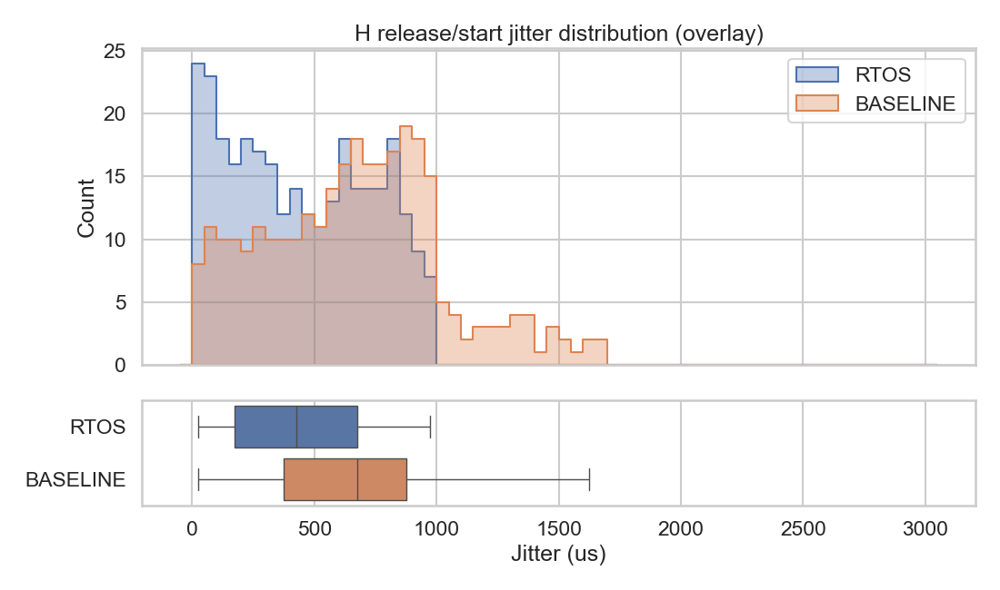
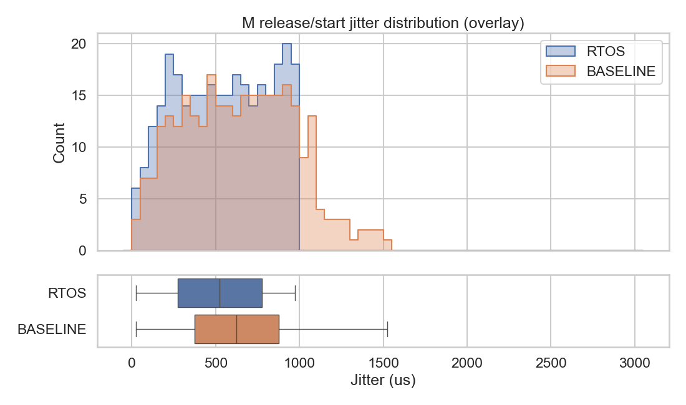
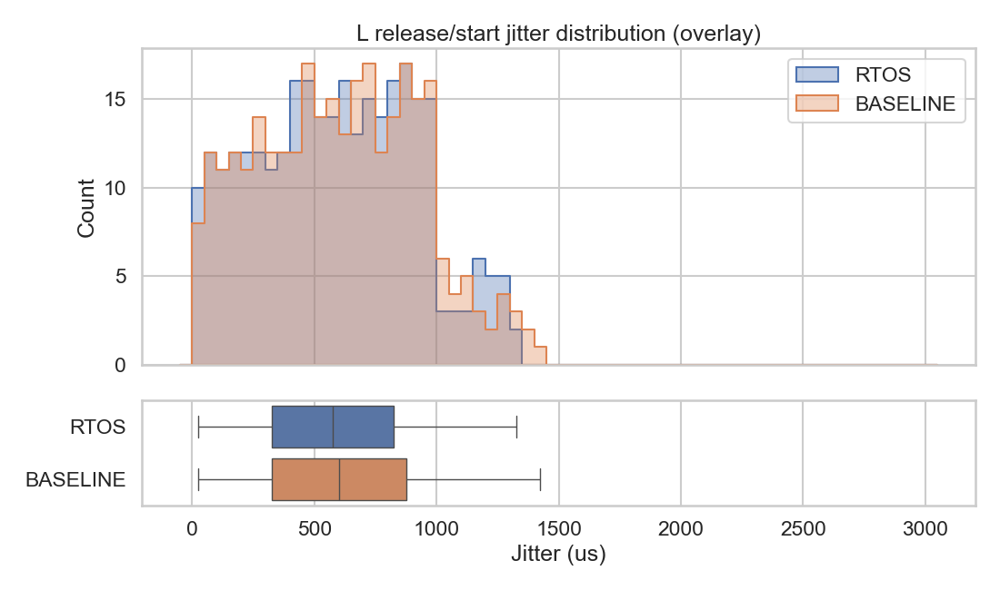

## Final Project: RTOS (Real-Time OS)

Name: Matthew Lee \
Date: March 19, 2026

This directory contains a small fixed-priority RTOS implemented on the RPi Zero, built from earlier class labs.

**Significance / what we show**: On a single-core system, a “real” RTOS feature is that a high-priority control loop can start promptly even if lower-priority work is running, by preempting it at a timer interrupt. This project demonstrates **true timer-IRQ preemption**, a **blocking mutex**, and measures how preemption changes both **release/start timing jitter** and **mutex wait behavior** compared to a deferred (non-preemptive) baseline.

### Overview

I implemented:

- A **fixed-priority scheduler** (highest priority READY thread runs).
- **True preemption** driven by the **ARM timer IRQ** (context switch happens inside the IRQ handler).
- **3 periodic kernel threads**:
  - `H`: 1kHz control loop (highest priority).
  - `M`: 2ms periodic worker.
  - `L`: 5ms task that also creates mutex contention.
- A **blocking mutex** with a priority-sorted wait queue.
- **Summary metrics** (printed once at the end):
  - **Release-to-start jitter** for each periodic task.
  - **Mutex lock latency** for tasks that contend.

### Key Code Components

Core files in this directory:

- [`rtos-kernel.c`](rtos-kernel.c): the RTOS runtime + the 3-task workload + Stats printing.
- [`interrupts-rtos-irq-asm.S`](interrupts-rtos-irq-asm.S): IRQ vector + full `regs_t` save and call into `timer_irq_handler(regs_t*)`.
- [`baseline-kernel.c`](baseline-kernel.c): the same kernel compiled with `NONPREEMPTIVE` to provide a baseline (no true preemption from the timer IRQ).
- [`Makefile`](Makefile): builds `rtos-kernel.bin` and `baseline-kernel.bin` and flashes them back-to-back.
- [`memmap`](memmap) and [`staff-start.S`](staff-start.S): local copies so this project can link/boot independently.

### What’s Reused vs. New

Reused from prior labs / `libpi`:

- The **boot/startup path** (`staff-start.S`) and **linker layout** (`memmap`) patterns from the interrupts labs.
- The lab-12 **context switch machinery**:
  - [`../12-preemptive/2-save-restore/switchto-asm.S`](../12-preemptive/2-save-restore/switchto-asm.S)
  - `regs_t` context format + `switchto()` / `switchto_mk()`.
- `libpi` device support: UART `printk`, interrupt controller helpers, ARM timer driver, and `timer_get_usec_raw()`.

New for this final project:

- **Full-context IRQ/SWI trampolines** in [`interrupts-rtos-irq-asm.S`](interrupts-rtos-irq-asm.S).
- **Scheduler + RTOS runtime** in [`rtos-kernel.c`](rtos-kernel.c):
  - fixed-priority selection, thread states (`READY/SLEEPING/BLOCKED`),
  - `rtos_sleep_until()`,
  - blocking mutex with a priority-sorted wait queue,
  - end-of-run jitter & latency summary.
- **Baseline build** plumbing in [`baseline-kernel.c`](baseline-kernel.c) (`#define NONPREEMPTIVE`).

### What Gets Printed (and what doesn’t)

- Each kernel prints **one summary block at the end** (either `RTOS stats ...` or `BASELINE stats ...`).
- We do **not** print per-tick or per-release logs in the final version (to keep timing cleaner and output small).

### How the RTOS Works (Runtime)

1. **Boot + interrupt setup**
   - `interrupt_init()` copies our IRQ entry table to address `0`.
   - `timer_init(16, 0x3d)` configures the ARM timer IRQ at ~1kHz.

2. **True preemption path (RTOS build)**
   - The IRQ entry assembly saves all registers into a `regs_t` array on the interrupt stack and calls `timer_irq_handler(regs_t*)`.
   - `timer_irq_handler()`:
     - clears the timer IRQ,
     - increments a tick counter,
     - wakes sleeping tasks by comparing `now_us >= wake_us`,
     - picks the highest-priority READY thread and immediately `switchto()`s it.

3. **Deferred baseline path (`NONPREEMPTIVE` build)**
   - The timer IRQ **still fires** at ~1kHz and still:
     - acknowledges/clears the timer interrupt,
     - wakes sleeping tasks whose `wake_us` has arrived (sets them `READY`).
   - The key difference is **what happens next**:
     - **RTOS**: the IRQ handler runs the scheduler and immediately `switchto()`s the chosen task.
     - **Baseline**: the IRQ handler usually **returns to the interrupted task**, so the CPU stays in that task until it hits a voluntary yield (sleep/block).

4. **Periodic task release (`rtos_sleep_until()`)**
   - Each task computes an `expected_us` for its next release.
   - If called early, it marks itself `TASK_SLEEPING`, stores `wake_us`, and yields via `swi`.
   - The timer IRQ marks tasks `TASK_READY` when their `wake_us` arrives.

5. **Blocking mutex (`mutex_lock` / `mutex_unlock`)**
   - Mutex has:
     - `owner` pointer,
     - `waitq_head` priority-sorted by thread priority.
   - `mutex_lock()`:
     - fast path: if `owner==0`, take ownership and return lock latency.
     - contended path: enqueue into wait queue, mark `TASK_BLOCKED`, and yield until ownership is handed over.
   - `mutex_unlock()`:
     - transfers ownership to the highest-priority waiter (if any), marks it `READY`, and sets `owner = waiter`.

### Single-Core Execution Model (RPi Zero)

This is a **single-core** CPU, so only one task runs at a time.

- At any instant, we run the **highest-priority READY** task.
- Which one runs changes over time based on:
  - timer releases (sleep → READY),
  - mutex blocking/unblocking,
  - and (in the RTOS build) timer-driven preemption.

In the **RTOS build**, the timer interrupt can preempt `M`/`L` at **timer-tick IRQ boundaries** (about 1kHz), so `H` can be dispatched promptly once it is READY.
In the **baseline build**, the timer IRQ still updates time and wakeups, but usually returns to the interrupted non-idle task; a switch typically happens only at **voluntary switch points** (`sleep`, `block`, or SWI/yield).

### Workload (What `H` / `M` / `L` do)

Each task executes `N_RELEASES` iterations and then stops. The last-finishing task prints the summary block and reboots.

- **H (1kHz, highest priority)**:
  - `rtos_sleep_until(next_release)`
  - record release/start jitter
  - `mutex_lock()` → bounded compute spin (`H_COMPUTE_US`) → `mutex_unlock()`
  - then advances to the next period
- **M (2ms)**:
  - `rtos_sleep_until(next_release)`
  - record jitter
  - bounded non-mutex compute (`M_COMPUTE_US`)
  - then advances to the next period
- **L (5ms, lowest priority)**:
  - `rtos_sleep_until(next_release)`
  - record jitter
  - `mutex_lock()` → **mutex-protected hold** (`L_HOLD_MUTEX_US`) → `mutex_unlock()`
  - then extra **non-mutex** compute (`L_EXTRA_COMPUTE_US`)
  - then advances to the next period

Clarification:

- `H` sleeps first, then does mutex work after release.
- In RTOS mode, preemption happens at timer IRQ boundaries.
- `L`'s extra compute after unlock is non-critical-section work and is freely preemptible without extending mutex hold time.

How a blocked mutex gets unblocked:

- If a task calls `mutex_lock()` while the mutex is owned, it:
  - enqueues itself on the mutex wait queue,
  - sets `TASK_BLOCKED`,
  - yields (SWI).
- When the owner later calls `mutex_unlock()`, it:
  - picks the highest-priority waiter (if any),
  - hands ownership to it (`owner = waiter`),
  - marks it `READY`.
- The blocked task continues once the scheduler runs it again; it resumes inside `mutex_lock()`, sees `owner == cur`, and returns.

### What We Measure

The workload is deterministic and periodic; we print:

- **Jitter** per task:
  - `jitter = actual_start_us - expected_release_us`
  - positive `jitter` means the task started late relative to its expected release time.
  - printed as `min/max/sum/samples` so you can compute average and spread offline.
- **Mutex lock latency** (only for tasks that call `mutex_lock()`):
  - measured as the time from entering `mutex_lock()` until it returns.
  - printed as `lock_lat: min/max/sum/samples`.

Definitions:

- **`N_RELEASES`**: how many periods each task runs before stopping and printing stats. With `N_RELEASES=100`, `H` runs ~100ms worth of releases (1ms period) and `L` runs ~500ms worth of releases (5ms period).
- **Jitter**: “how late did I start relative to when I should have started.”
- **Lock latency**: “how long did `mutex_lock()` take to return” (including any time blocked waiting for `L` to unlock).

### How to Build + Run

From the repo root:

```sh
make -C labs/final-project-RTOS run
```

Or from inside this directory:

```sh
cd labs/final-project-RTOS
make run
```

This flashes two binaries back-to-back over UART:

- `rtos-kernel.bin` prints `RTOS stats ...` (true preemptive scheduling).
- `baseline-kernel.bin` prints `BASELINE stats ...` (deferred/non-preemptive baseline).

### Results (N_RELEASES=300)

Numerical summary (avg/stddev computed from `sum` and `sumsq` printed over UART; the exact raw UART summary blocks from this run are saved in `plots/preemptive_log.txt` and `plots/baseline_log.txt`):

| Metric | RTOS (preemptive) | Baseline (deferred) |
|---|---:|---:|
| H jitter (us) | min=4, max=993, avg=442.30, sd=290.19 | min=11, max=1690, avg=661.89, sd=366.84 |
| M jitter (us) | min=8, max=988, avg=540.61, sd=277.15 | min=19, max=1516, avg=642.87, sd=329.50 |
| L jitter (us) | min=9, max=1318, avg=591.09, sd=327.64 | min=14, max=1420, avg=600.20, sd=330.70 |
| H lock latency (us) | min=1, max=366, avg=63.99, sd=134.27 | min=1, max=2, avg=1.19, sd=0.39 |
| L lock latency (us) | min=1, max=2, avg=1.34, sd=0.47 | min=1, max=2, avg=1.16, sd=0.36 |

### Interpreting the Results

What “RTOS vs non-RTOS” means here:

- The *preemptive* build can switch threads **directly inside the timer IRQ**.
- The *baseline* build still uses the timer for timekeeping and wakeups, but it **defers** the context switch until the currently running thread yields.

This configuration uses heavier mutex contention (see the `*_US` constants near the top of `rtos-kernel.c`) to make the scheduler difference visible in the jitter distributions.

Key observations:

- **Jitter**: RTOS reduces jitter for `H` and `M` (see table and plots).
- **Mutex**: in this workload, mutex acquisition is usually fast, with occasional waiting when `H` arrives while `L` is inside its bounded critical section. Since we don’t implement priority inheritance, preemption does not automatically mean “lower mutex wait.”

Why `H` lock latency is much higher in RTOS than baseline:

- In RTOS, `H` is dispatched sooner after release, so it more often reaches `mutex_lock()` while `L` is still inside its bounded critical section; that wait time appears directly in `H` lock-latency stats.
- In baseline, dispatch is deferred, so part of that waiting is shifted earlier into release/start delay (jitter), and by the time `H` runs the lock is often already free.
- So baseline can show lower lock latency while still having worse response timing; the delay is redistributed, not eliminated.

### Offline Analysis (Python)

We collect `min/max/sum/sumsq` and histogram bucket counts for **jitter** and **mutex lock latency** (printed once at the end over UART). We plot overlay histograms (RTOS vs baseline) with stacked boxplots for distribution comparison.

We generate plots using `analyze_metrics.py` with `matplotlib` and `seaborn`.

Setup with `uv` (recommended):

```sh
cd labs/final-project-RTOS
uv venv --python 3.11
source .venv/bin/activate
uv pip install -r requirements.txt
```

Example usage:

```sh
python analyze_metrics.py --preemptive /path/to/preemptive_log.txt --baseline /path/to/baseline_log.txt --outdir analysis_out
```

This prints tables to stdout and writes:

- `plots/overlay_h_jitter.png`
- `plots/overlay_m_jitter.png`
- `plots/overlay_l_jitter.png`

### Plots (overlay histograms)

H jitter (RTOS vs baseline overlay):



M jitter (RTOS vs baseline overlay):



L jitter (RTOS vs baseline overlay):



